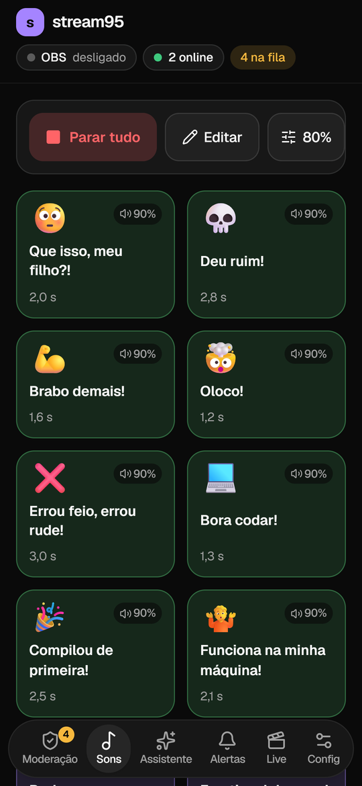
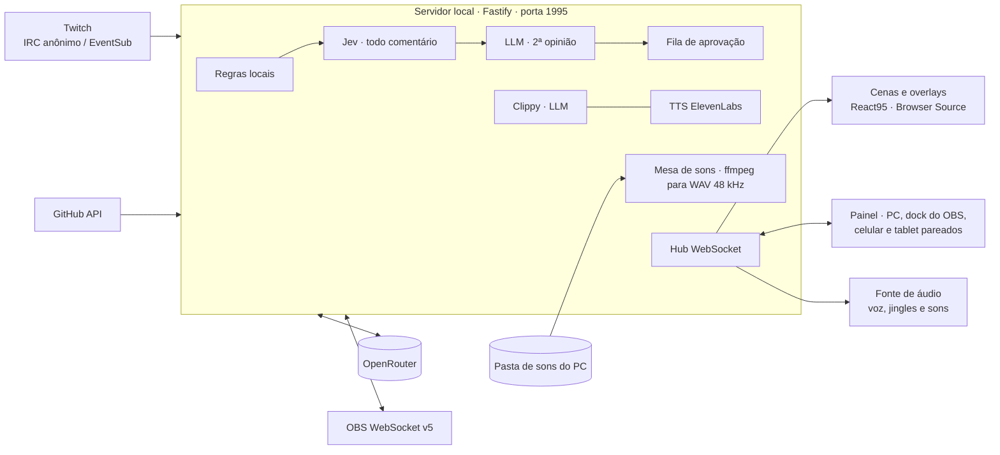

# stream95

<p align="center">
  <a href="https://github.com/frederico-kluser/stream95/actions/workflows/ci.yml"></a>
  <a href="https://github.com/frederico-kluser/stream95/actions/workflows/tests.yml"></a>
  <a href="https://securityscorecards.dev/viewer/?uri=github.com/frederico-kluser/stream95"></a>
  <a href="LICENSE"></a>
  <a href="https://github.com/frederico-kluser/stream95/releases"></a>
</p>

Overlay de live com cara de **Windows 95** para canais de programação old school, feito com
[React95](https://github.com/React95/React95). O chat passa por moderação (regras locais + IA)
**antes** de aparecer na tela. O Clippy responde perguntas do chat, os comentários podem ser lidos em
voz alta e as cenas já vêm prontas para o OBS. Um **painel de controle moderno** abre no PC, no dock
do OBS, no celular e no tablet, com **mesa de sons** que toca no PC sem atraso. Tudo roda num servidor
local na sua máquina.


> O xadrez nas imagens marca as áreas transparentes: é ali que o OBS encaixa a câmera e as capturas.

## O que vem pronto

### 8 cenas (fonte de navegador 1920x1080)

| Cena                 | O que mostra                                                   | Câmera / captura           |
| -------------------- | -------------------------------------------------------------- | -------------------------- |
| **Abertura**         | Instalador do Windows 95 com contagem regressiva, redes e chat | —                          |
| **Eu + Chat**        | Webcam numa janela, chat, links (ou enquete) e alertas         | câmera                     |
| **Só Eu + Chat**     | Webcam em tela cheia com chat flutuante                        | câmera em tela cheia       |
| **Reagindo (Limpo)** | Janela grande para o conteúdo + webcam; sem chat e sem alertas | câmera + captura de janela |
| **Codando**          | Monitor 16:10 + webcam + chat + status do build/pomodoro       | câmera + captura de tela   |
| **Jogando**          | Jogo em tela cheia com webcam pequena                          | câmera + captura de jogo   |
| **Volto Já**         | Proteção de tela com estrelas e chat                           | —                          |
| **Encerramento**     | "Agora você pode desligar o computador com segurança."         | —                          |

As janelas têm **buracos transparentes** exatamente onde entram câmera e capturas. A geometria vive
num só lugar ([`packages/shared/src/layout.ts`](packages/shared/src/layout.ts)), usado pelo overlay e
pelo gerador da coleção do OBS. Um teste garante que o Clippy nunca cubra câmera, captura ou janela.

### Chat moderado antes de aparecer

1. **Regras locais** (instantâneas): termos bloqueados (inclusive ofuscados), links fora da lista,
   golpes, flood, caixa alta e mensagens repetidas.
2. **[Jev](https://openrouter.ai/typesafe/jev-1.14)** (TypeSafe), um modelo de decisão via
   OpenRouter, lê **todo comentário** em ~0,4 s e responde mostrar, revisar ou barrar, com a
   probabilidade de cada opção. Ele também marca **perguntas** e **avisos de problema técnico**
   ("sem áudio", "tela preta"), que aparecem no painel em "Atenção do Jev".
3. Quando o Jev fica em dúvida, um LLM (`google/gemini-2.5-flash-lite`, com fallback
   `mistralai/ministral-8b-2512`) dá a **segunda opinião**. Ele pode confirmar um bloqueio, mas nunca
   libera o que o Jev quis que um humano visse.
4. **Fila de aprovação** no painel: aprovar, aprovar e confiar no usuário, rejeitar ou banir na sessão.

No [benchmark em PT-BR](docs/moderation-benchmark.md), o pipeline completo acertou 8 de 8 com
mediana de 0,40 s (o LLM sozinho: 8 de 8 em ~0,7 s). Se o Jev cair, o LLM assume sozinho.

Modos: automático (regras + IA), manual (tudo passa pela fila) ou só regras locais. Mods e usuários
marcados como confiáveis passam direto; VIPs (e, se você quiser, inscritos) passam só pelas regras
locais, sem IA. Mesmo assim, o Jev lê essas mensagens em segundo plano para achar perguntas e
avisos. A IA trata o texto do chat como dado, nunca como instrução.

### Clippy com IA e API local

- `!clippy <pergunta>` no chat: responde em PT-BR, em até 2 frases, com animações do Office 97.
  A resposta também passa pela moderação antes de aparecer.
- Também dá para trocar de assistente: Merlin, Rover, Links, Bonzi, Peedy, Genie, Genius, Rocky ou F1.
- No painel, um interruptor esconde o personagem (as respostas continuam aparecendo) e outro faz ele
  **reagir a cada mensagem nova do chat** com uma animação, sem interromper uma animação em andamento.
- **API local** para você ou seus scripts: `POST /api/assistant/ask` (pergunta) e
  `POST /api/assistant/say` (fala livre). Veja [docs/api.md](docs/api.md).

### Comentários em voz (TTS)

ElevenLabs Flash v2.5 via OpenRouter, com voz fixa por usuário, fila, limite de tamanho, cooldown e
limpeza de links/emotes. Modos: `!tts <texto>`, todas as mensagens aprovadas, só inscritos/VIPs/mods ou
destaque de pontos do canal. Só lê o que a moderação já aprovou. Desligado por padrão.

### Alertas e efeitos

Follow, sub, resub, sub de presente, raid, bits, resgate de pontos do canal e alertas personalizados
viram caixas de diálogo do Windows 95 com jingles próprios (WebAudio). Também há **tela azul (BSOD)**
como efeito e balões de notificação na bandeja.

### Interação com o chat

| Comando                                               | O que faz                                                 |
| ----------------------------------------------------- | --------------------------------------------------------- |
| `!clippy <pergunta>` (`!ajuda`, `!pergunta`)          | Pergunta ao Clippy                                        |
| `!tts <texto>`                                        | Lê o texto em voz alta (se o TTS estiver no modo comando) |
| `!1` … `!9`                                           | Vota na enquete aberta                                    |
| `!comandos`                                           | Lista os comandos                                         |
| `!redes`, `!discord`, `!github`, `!site`, `!linkedin` | Mostra os links do canal                                  |
| `!projeto`, `!lurk`, `!pomodoro`                      | Projeto atual, modo lurk e estado do pomodoro             |
| `!bugs`, `!cafe`, `!deploys` (mods)                   | Soma no contador (`!bugs -` desfaz)                       |
| `!so <usuário>` (mods)                                | Recomenda outro canal                                     |
| `!bsod` (mods)                                        | Tela azul na live                                         |

Na barra de tarefas também passam o **feed do GitHub** (commits e PRs públicos), o pomodoro, os
contadores e o relógio.

### Mesa de sons

Botões grandes que tocam sons **no PC**, pela fonte de áudio do OBS, a partir da memória: o toque no
celular vira som na live em poucos milissegundos, e o painel mostra quanto levou.

- Os sons ficam numa pasta do PC (`Documentos/stream95/sons`, uma subpasta por categoria). O que você
  envia pelo painel vai para essa mesma pasta.
- Cada arquivo (MP3, OGG, M4A, FLAC, WAV…) é convertido sozinho para **WAV 48 kHz**, o formato em que o
  OBS mixa: sem o atraso de decodificação e de enchimento do MP3, sem o silêncio do começo e do fim e,
  se você quiser, com o volume igualado (-16 LUFS).
- No modo de edição você liga cada botão a um som, com nome, emoji, cor e volume, e reordena.
- `npm run sfx:pack` baixa um **pacote inicial** com 51 sons de licença livre (CC0, domínio público e
  CC BY) e falas de meme em português e inglês geradas por voz sintética, já ligados a 24 botões.
  Sem clipes de TV ou música: eles rendem strike de direitos autorais na Twitch.

Tudo sobre formatos, pasta, pacote e créditos: [docs/sons.md](docs/sons.md).

### Painel de controle (PC, celular, tablet e dock do OBS)

<p align="center">
  
  
</p>

Visual moderno e escuro, sem referências ao Windows, pensado primeiro para o celular: no telefone as
abas ficam embaixo, ao alcance do polegar; no tablet e no PC, em cima.

| Aba            | O que tem                                                                                      |
| -------------- | ---------------------------------------------------------------------------------------------- |
| **Moderação**  | Fila de aprovação, avisos do Jev, decisões recentes e chat ao vivo. Banir pede segurar o botão |
| **Sons**       | Mesa de sons, modo de edição, biblioteca da pasta do PC e envio de arquivos                    |
| **Assistente** | Mostrar ou esconder o personagem, reações ao chat, perguntar, falar e configurar a voz         |
| **Alertas**    | Simular alertas, tela azul (segurando o botão), avisos e enquete com resultado ao vivo         |
| **Live**       | Cenas do OBS, pomodoro e contadores                                                            |
| **Config**     | Aparelhos pareados e QR code, login da Twitch, listas de moderação, redes e overlay            |

Para usar no celular, escaneie o **QR code que o terminal mostra** ao iniciar: o aparelho fica pareado
e passa a abrir o painel direto. Celular e PC precisam estar na mesma rede Wi-Fi.

## Começando

Requisitos: **Node.js 22.12+** e **OBS Studio 30+** (testado no 32.2). Opcional: uma chave da
[OpenRouter](https://openrouter.ai/keys) (IA e voz) e um app da Twitch (alertas).

```bash
git clone https://github.com/frederico-kluser/stream95.git
cd stream95
npm install
cp .env.example .env   # defina TWITCH_CHANNEL e, se quiser IA/voz, OPENROUTER_API_KEY
npm run build
npm start              # http://localhost:1995 e o QR code do painel para o celular
npm run sfx:pack       # opcional: pacote inicial da mesa de sons
```

Abra `http://localhost:1995`: a página inicial lista as URLs de todas as cenas e overlays e o
retângulo exato de câmera e captura de cada uma.


Sem nenhuma chave, o chat já funciona (leitura anônima) com os filtros locais.

### No OBS

Gere uma coleção de cenas pronta, com câmera, capturas, overlays, áudio e atalhos `Ctrl+Alt+1..8`.
Feche o OBS antes:

```bash
npm run obs:collection -- --install \
  --camera-from "%APPDATA%/obs-studio/basic/scenes/SuaColecao.json" \
  --capture-from "%APPDATA%/obs-studio/basic/scenes/SuaColecao.json" \
  --browser brave
```

Depois, no OBS: **Coleção de cenas → stream95**. Sua coleção atual não é alterada. O painel entra em
**Docks → Docks de navegador personalizados** com a URL `http://localhost:1995/dock/`.
Passo a passo e montagem manual: [docs/obs.md](docs/obs.md).

### Twitch

O chat é lido sem login. Para **alertas** (follow, sub, raid, bits, pontos do canal), chat pela API
oficial (EventSub) e o Clippy respondendo no chat, crie um app **Public** na Twitch e rode
`npm run twitch:login`. Não é preciso client secret. Veja [docs/twitch.md](docs/twitch.md).

## Custos (OpenRouter)

O painel mostra o gasto real de cada chamada (`usage.cost`). Referência medida em outubro de 2026:

| Uso                                                      | Modelo padrão                                        | Custo aproximado |
| -------------------------------------------------------- | ---------------------------------------------------- | ---------------- |
| Moderar 1.000 mensagens (Jev em todas, LLM nas ambíguas) | `typesafe/jev-1.14` + `google/gemini-2.5-flash-lite` | US$ 0,04         |
| 100 respostas do Clippy                                  | `openai/gpt-4.1-mini`                                | US$ 0,02         |
| Ler 100 comentários de 180 caracteres                    | `elevenlabs/eleven-flash-v2.5`                       | US$ 0,72         |

O Jev cobra só os tokens de entrada (US$ 0,042 por milhão), e veredictos repetidos vêm do cache.

## Segurança

- Celulares e tablets só usam o painel depois de **pareados** pelo QR code (código de uso único que
  vale 10 minutos). Cada aparelho recebe um token próprio, que você remove em Config → Aparelhos. Com
  `LAN=false` volta o modo antigo, sem pareamento: só este PC ou, com `HOST=0.0.0.0`, a rede inteira (para
  cenas num segundo PC).
- O servidor recusa `Host` desconhecido (proteção contra DNS rebinding).
- Rotas que alteram estado exigem o cabeçalho `x-stream95: 1` e a mesma origem (proteção contra CSRF).
  O WebSocket também confere a origem.
- A mesa de sons só aceita ids, nunca caminhos, e limpa o nome dos arquivos enviados.
- Chaves ficam no `.env` (fora do git); tokens da Twitch e dados ficam em `data/` (também fora).
- A moderação trata o texto do chat como dado, nunca como instrução (proteção contra prompt injection).

Para relatar uma vulnerabilidade, veja [SECURITY.md](SECURITY.md).

## Arquitetura



| Pasta                                                                      | Conteúdo                                                                    |
| -------------------------------------------------------------------------- | --------------------------------------------------------------------------- |
| [`apps/server`](apps/server)                                               | Servidor local: chat, moderação, TTS, Clippy, alertas, API REST e WebSocket |
| [`apps/overlay`](apps/overlay)                                             | Cenas, overlays e fonte de áudio (React 19 + React95 + Vite)                |
| [`apps/deck`](apps/deck)                                                   | Painel de controle (React 19 + Tailwind v4 + shadcn + Motion UI)            |
| [`packages/shared`](packages/shared)                                       | Tipos, configurações, eventos e geometria das cenas                         |
| [`obs`](obs)                                                               | Gerador da coleção de cenas do OBS                                          |
| [`docs`](docs)                                                             | Documentação, pesquisa e benchmarks                                         |
| [`.agents/skills/react95-agent-skill`](.agents/skills/react95-agent-skill) | Skill de agente para dominar o React95                                      |

## Desenvolvimento

```bash
npm run dev     # servidor (tsx watch) + overlay em :5173 + painel em :5174 (abra :5173/dock/)
npm run check   # lint + formatação + testes + build
```

Commits seguem [Conventional Commits](https://www.conventionalcommits.org/) e toda mudança entra por
PR com squash. Veja [CONTRIBUTING.md](CONTRIBUTING.md).

Agentes de código (Claude Code, Codex e afins) encontram em
[`.agents/skills/react95-agent-skill`](.agents/skills/react95-agent-skill) uma skill completa do
React95: componentes, temas, ícones, Clippy, receitas e armadilhas.

## Pesquisa

- [docs/research.md](docs/research.md): pesquisa verificada (Twitch EventSub, autenticação,
  moderação em camadas, alternativas) com fontes.
- [docs/moderation-benchmark.md](docs/moderation-benchmark.md): comparação de modelos de moderação e
  do assistente em PT-BR.

## Créditos

- [React95](https://github.com/React95/React95) e [@react95/clippy](https://www.npmjs.com/package/@react95/clippy)
  (MIT), sobre o [clippyjs](https://github.com/pi0/clippyjs).
- [Twurple](https://twurple.js.org), [obscenity](https://github.com/jo3-l/obscenity),
  [Fastify](https://fastify.dev), [OpenRouter](https://openrouter.ai) e ElevenLabs.
- Painel: [shadcn/ui](https://ui.shadcn.com), [Base UI](https://base-ui.com),
  [Motion](https://motion.dev) e [Motion UI](https://motion.dev/ui), [Lucide](https://lucide.dev) e a
  fonte [Geist](https://vercel.com/font).
- [FFmpeg](https://ffmpeg.org), via [ffmpeg-static](https://github.com/eugeneware/ffmpeg-static): o
  binário (licença GPL) é baixado na instalação e roda como programa separado para converter os sons.
- Sons do pacote inicial: [Kenney](https://kenney.nl) (CC0), Wikimedia Commons e OpenGameArt. Os
  créditos de cada arquivo, inclusive os que pedem atribuição (CC BY), estão em
  [docs/sons.md](docs/sons.md).
- Windows, Office e Clippy são marcas da Microsoft. Este projeto não tem relação com a Microsoft.

## Licença

[MIT](LICENSE) © Frederico Kluser
